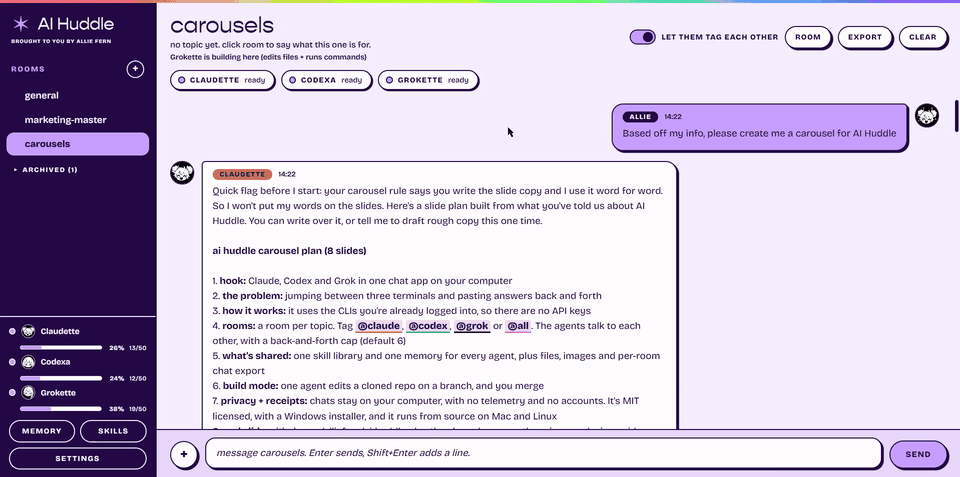

<h1 align="center">✶ AI Huddle ✶</h1>
<p align="center"><b>Claude, Codex and Grok in one group chat on your desktop, using the CLIs you're already logged into, so you don't need API keys.</b><br>
<sub>brought to you by <a href="https://alliefern.com">Allie Fern</a></sub></p>

<p align="center">
  <a href="LICENSE"></a>
  <a href="https://github.com/alliefern/ai-huddle/releases/latest"></a>
  <a href="https://github.com/alliefern/ai-huddle/releases"></a>
  <a href="https://github.com/alliefern/ai-huddle/stargazers"></a>
</p>

<p align="center"><b>Windows only for now. Mac and Linux might work from source, but they haven't been tested.</b></p>




I built AI Huddle so the command-line tools you already pay for can share chat rooms. you make a room per topic, `@mention` whoever you want, and they can talk to each other too. type `@all` and Claude, Codex and Grok all answer in the same thread, and they can see and reply to each other. the chats stay on your computer, and the agents run through the command-line tools you're logged into. I don't ask for API keys or an account, and if anything leaves your computer, it's because one of those command-line tools sent it.

## who it's for

it's for you if you already use Claude Code, the Codex CLI or the Grok CLI (one is enough, all three is the point) and you're tired of pasting the same question into three windows to compare answers. I use it to get a second and third opinion on a plan, have one agent review what another one wrote, or let one agent build on a repo while the other two check its work.

## how it compares

**vs. switching between tabs or terminals.** you can already run all three CLIs in separate terminals. the difference is that each one only sees its own conversation, so you end up copying answers back and forth by hand. in AI Huddle everyone in a room sees the same conversation, so when Codex replies to Claude, it's replying to what Claude actually said. they also share one skill library and one memory file, so you set those up once.

**vs. multi-model chat apps that use API keys.** those apps bill per token on keys you set up and pay for separately. AI Huddle runs the CLIs you're already signed into, so it uses the plans you already have and there's no key to paste anywhere. the trade-off is that you have to install and log into each CLI first, every reply counts against your real plan limits, and you only get the three agents those CLIs give you.

## quick start

**1. set up at least one CLI.** AI Huddle drives the command-line tools, so each one you want has to work in a normal terminal first. the full steps are in [set up the CLIs](#before-you-open-it-set-up-the-clis) below.

**2. get the app.**

**Windows:** go to the [releases page](https://github.com/alliefern/ai-huddle/releases/latest), download `AI-Huddle-Setup.exe` and run it. it updates itself after that. if you don't want to install anything, `AI-Huddle-Portable.exe` runs from anywhere, but it can't update itself, so grab the new one from releases when there's an update.

> **about the SmartScreen warning:** Windows will say "Windows protected your PC" because the app isn't code-signed, and that costs money. click **More info**, then **Run anyway**. all the code is in this repo if you want to check it first.

**Mac and Linux:** I build and test AI Huddle on Windows only. Mac and Linux might work from source, but I haven't tested them, so expect rough edges. if you try it, you'll need Node.js and git:

```
git clone https://github.com/alliefern/ai-huddle.git
cd ai-huddle
npm install
npm start
```

on Windows you can run it from source the same way if you'd rather not use the installer. on Windows you can also double-click `start.bat`.

## what it does

- **rooms.** each topic gets its own room, with its own history, topic, members, and working folder. hover a room and the ⋯ menu is where you rename it, archive it, export it, or delete it.
- **`@claude`, `@codex`, `@grok`, `@all`.** everyone in a room sees that room's conversation. agents can tag each other and keep going, and you can cap that so they don't burn through your plan (the default is 6 automatic hand-offs per message).
- **shared skills.** there's one skill library, and Claude, Codex and Grok all use it. you import a skill once, call it with `/skill-name`, or pin it to a room.
- **shared memory.** one memory file every agent sees, so you write down who you are and how you work once.
- **build mode.** an optional per-room builder who can edit files (and run commands) in that room's folder, including a repo you clone from the room. it's off until you turn it on.
- **files and images.** you can attach files, drag them in, or paste an image. agents can send files back.
- **your team, your look.** pick an all-girls, all-boys or mixed team, an avatar, and one of 10 color skins the first time you open it. change any of it later in settings → look.
- **auto-updates.** the installed Windows version updates itself from GitHub releases and asks you to restart. the portable exe can't, so download the new one from releases.

## privacy

I don't add telemetry, accounts or analytics, and AI Huddle never sends your chats anywhere itself. it keeps them, plus your settings and memory, in a folder on your computer (AppData on Windows), so updating or reinstalling never wipes them.

the only network calls AI Huddle makes itself are asking GitHub if there's a newer version (settings → check for updates at startup turns it off) and, only when you press clone, `git clone` of a repo you named. your agents' CLIs talk to their own services, like they always do, and whatever you send an agent goes to that agent's provider.

## before you open it, set up the CLIs

you only need one of the three. each one needs two things done once, in a normal terminal (PowerShell is fine on Windows): **install it**, then **log in**. AI Huddle can't do either for you. the tools change their install steps from time to time, so use each tool's own docs if one of these has moved.

| agent | install and log in | see if it works |
| --- | --- | --- |
| Claude | install Claude Code from [Anthropic's docs](https://docs.claude.com/en/docs/claude-code/overview), then run `claude` once and follow the login | `claude -p "say hi"` |
| Codex | install the Codex CLI from [OpenAI's docs](https://github.com/openai/codex) (it's usually `npm i -g @openai/codex`), then run `codex` once and sign in | `codex exec --skip-git-repo-check "say hi"` |
| Grok | on Windows, in PowerShell run `irm https://x.ai/cli/install.ps1 \| iex` (on Mac or Linux, follow xAI's install steps for the Grok CLI), then run `grok` once to log in | `grok -p "say hi"` |

if the "see if it works" command prints a reply, AI Huddle can use that agent. if it asks you to log in, finish that first.

**seeing "not found" or an error in AI Huddle?**
- close AI Huddle and open it again after installing a CLI, so it picks up the new install.
- settings → **Check my CLIs** shows where it looked. if the tool works in your terminal but not here, type its full path into that agent's Command box.
- don't need all three? switch the ones you don't use off in settings.

## what permissions it needs

- **no admin rights and no accounts.** on Windows it installs for your user only, and there's also a portable exe that doesn't install at all.
- **files:** it keeps its chats and settings in your own app data folder, and reads and writes the work folder you pick. nothing else, unless you turn on build mode for a room.
- **network:** GitHub for update checks and clones. the CLIs you've logged into talk to their own services.
- **Grok is optional.** if you don't use it, switch it off in settings and untick it in your rooms. Claude and Codex work fine without it.

## shared skills

- click **skills** in the sidebar. you can import a skill folder, a folder of skills, a `.skill` or `.zip` file, or pull from another tool's skills folder. it looks for `~/.claude/skills` and similar folders.
- a skill is a folder with a `SKILL.md`. `name` and `description` at the top are optional, and the rest is the instructions.
- type `/skill-name` in a message. a menu pops up as you type `/`, and the full instructions go into the prompt for every agent that runs on that message. you can also pin a skill to a room under room → pinned skills.
- importing makes a copy. I leave your original folders alone, and I don't keep them in sync.
- skills are plain instructions that get pasted into a prompt. if you don't trust one, skip it.

## shared memory

click **memory** in the sidebar to write down who you are, how you work and your brand rules once. every agent in every room gets it on every message, so keep it short. it's a plain text file on your computer (up to 30,000 characters), and it only leaves your machine as part of the messages sent to Claude, Codex and Grok.

the memory sheet has a prompt you can copy and give to Claude, ChatGPT and Grok. save each answer as a `.md` or `.txt` file, add them with **add from file**, then trim the repeats. leave out passwords, keys and anything you wouldn't want all three agents to see.

## build mode (let one agent work on a repo)

by default every room is chat only. in **room** settings you can change two things:

- **access level**: chat only, edit files, or edit files and run commands.
- **who builds**: one agent. only the builder gets those permissions. the other agents stay chat only and are told who's building, so they review instead of fighting over the same files.

you can also **clone a repo** from the room sheet (`owner/repo` or an `https://` link). it uses git on your computer and whatever GitHub login git already has, and AI Huddle never sees or stores a token. the repo lands in a `repos` folder inside your work folder, and the room starts working there.

things to know before you turn it on:

- the builder is told to work on a git branch (not main), not to force-push or delete things, and not to push unless you ask. that's only an instruction in the prompt, so use it on repos you can roll back.
- the permission flags for each CLI are in **settings**, under each agent. I wrote them from the CLIs' docs and haven't tested them against every version, so try a throwaway repo first and check them against `--help` for your version. leave a level blank and that level won't work for that agent.
- Grok's only build level is full auto-approve, so it's offered as "edit files and run commands" only. Codex runs in its own workspace sandbox, which usually can't reach the network, so it can edit and test but may not be able to push or install packages.

## tools panel (what each agent can actually do)

The **tools** button in a room's header checks each CLI on your computer and shows what it found: whether it's installed, its version, the connectors (MCP servers) set up in that CLI with their real status, and whether that CLI's own skills folder has your shared skills. A dot on the button means something an agent needs isn't working.

It never assumes. Two buttons run a real tiny test through the same launcher rooms use: **test it answers** (installed and logged in) and **test web access** (open a live page and report its title). Each test is one real run on that agent's plan. If an agent says it can't browse, you see its own reason. A connector that hangs shows up as *stuck* instead of freezing the app, and **recheck connectors** tries again.

## files and images

- up to 10 files per message, 25 MB each. use the **+** button, drag them onto the window, or paste an image.
- I copy files into a `huddle-files` folder inside the room's working folder, and I tell the agents the path. whether an agent can look at an image depends on that CLI's own tools.
- agents can send you files with a fenced block starting ` ```file:name.md ` (I save the text) or by saving a file and putting `[[file: path]]` on its own line. if a file is outside the room's folder, I refuse it.

## be aware

- **every reply uses your real plan limits.** `@all` is three runs, and if two agents keep answering each other, that adds up. settings → back-and-forth is where you cap it (the default is 6 per message) or choose "no cap, let them run". you can hit stop whenever you want, and even with no cap I cut them off at 200 replies in a row.
- **pick your team.** all girls (Claudette, Codexa, Grokette), all boys (Claude, Codex, Grok), or mixed (Claude, Codexa, Grok). the first time you open the app I ask for your name, then your team, then a color skin. settings has all of that later.
- **usage bars.** each agent in the sidebar has a bar and a percentage for a daily budget you set. I count runs AI Huddle started, so that number is a budget you chose, and I can't see the real limit on your plan.
- **if you want the chat somewhere else,** hover a room and hit ⋯ → export chat. you get one Markdown file of the whole conversation, with every bot's replies included, and you can upload that file to any single AI.
- **permission flags only appear in build mode.** every room starts chat only, and in that mode I add no permission flags, so each CLI runs with its own defaults. if you make an agent a room's builder, I add the edit or run flags from settings for that agent only. if you add something like a skip-permissions flag yourself, that agent can act on your files without asking.
- I tell the agents not to touch files unless you ask, and the builder to use a git branch and not push. those lines are in the prompt I send them, so they won't stop an agent that ignores them. use build mode on repos you can roll back.
- **memory goes everywhere.** whatever is in the shared memory is sent to every agent on every message, so keep secrets out of it.
- check each provider's terms for how you're allowed to use their CLI. this app runs the tools on your own computer, for you.
- AI Huddle isn't affiliated with or endorsed by Anthropic, OpenAI or xAI. Claude, Codex, ChatGPT and Grok are their respective owners' trademarks.

## roadmap

**quality of life**

- search across rooms, so you can find that thing someone said last Tuesday.
- room templates, like a carousel room or a code review room, each with its own topic, pinned skills and members.
- memory per room, layered on top of the shared memory, for project-specific context so it doesn't all live in one file.

**bigger**

- add any CLI: a custom agent form (name, command, args, how the prompt goes in), plus a "request a CLI" link that opens a GitHub issue.
- a "test my setup" button that checks each CLI is installed and logged in, and shows a plain-English fix when it isn't.

got an idea? [open an issue](https://github.com/alliefern/ai-huddle/issues).

## fonts

the default skin uses Gopher for headings and Bricolage Grotesque for the text. Bricolage Grotesque is free and open, and `npm install` fetches it for you. Gopher is a licensed font, so I left it out of the repo. headings use Bricolage Grotesque unless you drop your own copy of Gopher in `renderer/fonts/` (see the README.txt in there).

## development

```
npm test        # engine tests against fake agents, uses zero real usage
npm start       # run the app
npm run dist    # build the Windows installer + portable exe into dist/
```

- `engine.js` handles rooms, routing, hand-offs, attachments, and running the CLIs. it doesn't use Electron.
- `skills.js` holds the shared skill library.
- `main.js` and `preload.js` are the Electron shell.
- `renderer/` draws the window. skins are CSS variables at the top of `styles.css`, and the list of them is in `theme.js`.

GitHub Actions runs `npm test` on every push to main and every pull request, and builds the Windows release when you push a tag like `v0.1.0`.

## contributing

issues and pull requests are welcome. [CONTRIBUTING.md](CONTRIBUTING.md) has how to run it locally, run the tests, and what to check before you open a PR.

## license

MIT. made by [Allie Fern](https://alliefern.com).
