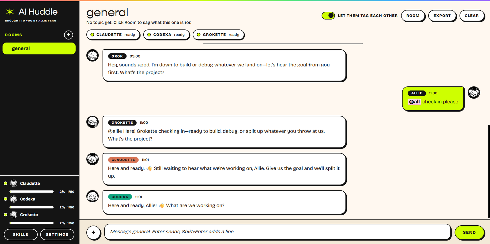

<h1 align="center">✶ AI Huddle ✶</h1>
<p align="center"><b>Claude, Codex and Grok in one chat app on your computer, using the CLIs you're already logged into, so you don't need API keys.</b><br>
<sub>brought to you by <a href="https://alliefern.com">Allie Fern</a></sub></p>



I built AI Huddle so the command-line tools you already pay for can share chat rooms. you make a room per topic, `@mention` whoever you want, and they can talk to each other too. I keep the chats on your computer, and the agents run through the command-line tools you're logged into. I don't ask for API keys or an account, and if anything leaves your computer, it's because one of those command-line tools sent it.

## what it does

- **rooms.** each topic gets its own room, with its own history, topic, members, and working folder. hover a room and the ⋯ menu is where you rename it, archive it, or delete it.
- **`@claude`, `@codex`, `@grok`, `@all`.** everyone in a room sees that room's conversation. agents can tag each other and keep going, and you can cap that so they don't burn through your plan.
- **shared skills.** there's one skill library, and Claude, Codex and Grok all use it. you import a skill once, call it with `/skill-name`, or pin it to a room.
- **files and images.** you can attach files, drag them in, or paste an image. agents can send files back.
- **your team, your look.** pick an all-girls, all-boys or mixed team, an avatar, and one of 10 color skins the first time you open it. change any of it later in settings → look.
- **on your computer.** I don't add telemetry, accounts or analytics, and your chats never leave your computer. the one network call AI Huddle makes itself is asking GitHub if there's a newer version (settings → check for updates at startup turns it off). your agents' CLIs talk to their own services, like they always do.
- **auto-updates.** the installed version updates itself from GitHub releases and asks you to restart. the portable exe can't, so download the new one from releases.

## install

**Windows (the easy way):** go to the [releases page](https://github.com/alliefern/ai-huddle/releases/latest), download `AI-Huddle-Setup.exe` and run it. it updates itself after that.

- Windows will say "Windows protected your PC" because the app isn't code-signed, and that costs money. click **More info**, then **Run anyway**.
- don't want to install? `AI-Huddle-Portable.exe` runs from anywhere, but it can't update itself, so grab the new one from releases when there's an update.
- your chats and settings live in your AppData folder, so updating or reinstalling never wipes them.

**from source** (Windows, Mac or Linux):

```
git clone https://github.com/alliefern/ai-huddle.git
cd ai-huddle
npm install
npm start
```

build your own installer with `npm run dist` (Windows). on Windows you can also double-click `start.bat` or `build.bat`.

## before you open it, set up the CLIs

AI Huddle drives the command-line tools, so each one you want has to work in a normal terminal first, and you have to be logged in, though you don't need all three.

| agent | see if it works |
| --- | --- |
| Claude | `claude -p "say hi"` |
| Codex | `codex exec --skip-git-repo-check "say hi"` |
| Grok | `grok -p "say hi"` (install with `irm https://x.ai/cli/install.ps1 \| iex` in PowerShell, then run `grok` once to log in) |

after you install one, close AI Huddle and open it again, then use **settings → check my CLIs** to see where each one was found. anything missing shows "not found", and you can switch it off.

## shared skills

- click **skills** in the sidebar. you can import a skill folder, a folder of skills, a `.skill` or `.zip` file, or pull from another tool's skills folder. it looks for `~/.claude/skills` and similar folders.
- a skill is a folder with a `SKILL.md`. `name` and `description` at the top are optional, and the rest is the instructions.
- type `/skill-name` in a message. a menu pops up as you type `/`, and the full instructions go into the prompt for every agent that runs on that message. you can also pin a skill to a room under room → pinned skills.
- importing makes a copy. I leave your original folders alone, and I don't keep them in sync.
- skills are plain instructions that get pasted into a prompt. if you don't trust one, skip it.

## shared memory

Click **memory** in the sidebar to write down who you are, how you work and your brand rules once. Every agent in every room gets it on every message, so keep it short. It's a plain text file on your computer (up to 30,000 characters), and it only leaves your machine as part of the messages sent to Claude, Codex and Grok.

The memory sheet has a prompt you can copy and give to Claude, ChatGPT and Grok. Save each answer as a `.md` or `.txt` file, add them with **add from file**, then trim the repeats. Leave out passwords, keys and anything you wouldn't want all three agents to see.

## build mode (let one agent work on a repo)

By default every room is chat only. In **room** settings you can change two things:

- **access level**: chat only, edit files, or edit files and run commands.
- **who builds**: one agent. Only the builder gets those permissions. The other agents stay chat only and are told who's building, so they review instead of fighting over the same files.

You can also **clone a repo** from the room sheet (`owner/repo` or an `https://` link). It uses git on your computer and whatever GitHub login git already has. AI Huddle never sees or stores a token. Everything is local. The repo lands in a `repos` folder inside your work folder, and the room starts working there.

Things to know before you turn it on:

- The builder is told to work on a git branch (not main), not to force-push or delete things, and not to push unless you ask. That's an instruction, not a lock, so use it on repos you can roll back.
- The permission flags for each CLI are in **settings**, under each agent. I wrote them from the CLIs' docs and haven't tested them against every version, so try a throwaway repo first and check them against `--help` for your version. Leave a level blank and that level won't work for that agent.
- Grok's only build level is full auto-approve, so it's offered as "edit files and run commands" only. Codex runs in its own workspace sandbox, which usually can't reach the network, so it can edit and test but may not be able to push or install packages.

## files and images

- up to 10 files per message, 25 MB each. use the **+** button, drag them onto the window, or paste an image.
- I copy files into a `huddle-files` folder inside the room's working folder, and I tell the agents the path. whether an agent can look at an image depends on that CLI's own tools.
- agents can send you files with a fenced block starting ` ```file:name.md ` (I save the text) or by saving a file and putting `[[file: path]]` on its own line. if a file is outside the room's folder, I refuse it.

## be aware

- **every reply uses your real plan limits.** `@all` is three runs. if two agents keep answering each other, that adds up. settings → back-and-forth is where you cap it (the default is 6 per message) or choose "no cap, let them run". you can hit stop whenever you want, and even with no cap I cut them off at 200 replies in a row.
- **pick your team.** all girls (Claudette, Codexa, Grokette), all boys (Claude, Codex, Grok), or mixed (Claude, Codexa, Grok). the first time you open the app I ask for your name, then your team, then a color skin. settings has all of that later.
- **usage bars.** each agent in the sidebar has a bar and a percentage for a daily budget you set. I count runs AI Huddle started. that number is a budget you chose, and I can't see the real limit on your plan.
- **if you want the chat somewhere else,** hover a room and hit ⋯ → export chat. you get one Markdown file of the whole conversation, with every bot's replies included, and you can upload that file to any single AI.
- **I don't add permission flags.** each CLI runs with its own defaults. if you add something like a skip-permissions flag, that agent can act on your files without asking, in the room's folder.
- I tell the agents not to touch files unless you ask. that line is in the prompt I send them, so it won't stop an agent that ignores it.
- check each provider's terms for how you're allowed to use their CLI. this app runs the tools on your own computer, for you.
- AI Huddle isn't affiliated with or endorsed by Anthropic, OpenAI or xAI. Claude, Codex, ChatGPT and Grok are their respective owners' trademarks.

## fonts

the default skin uses Gopher for headings and Bricolage Grotesque for the text. Bricolage Grotesque is free and open, and `npm install` fetches it for you. Gopher is a licensed font, so I left it out of the repo. headings use Bricolage Grotesque unless you drop your own copy of Gopher in `renderer/fonts/` (see the README.txt in there).

## development

```
npm test        # engine tests against fake agents, uses zero real usage
npm start       # run the app
npm run dist    # build the Windows installer + portable exe into dist/
```

- `engine.js` handles rooms, routing, hand-offs, attachments, and running the CLIs. it doesn't use Electron.
- `skills.js` holds the shared skill library.
- `main.js` and `preload.js` are the Electron shell.
- `renderer/` draws the window. skins are CSS variables at the top of `styles.css`, and the list of them is in `theme.js`.

GitHub Actions builds the release when you push a tag like `v0.1.0`.

## license

MIT. made by [Allie Fern](https://alliefern.com).
